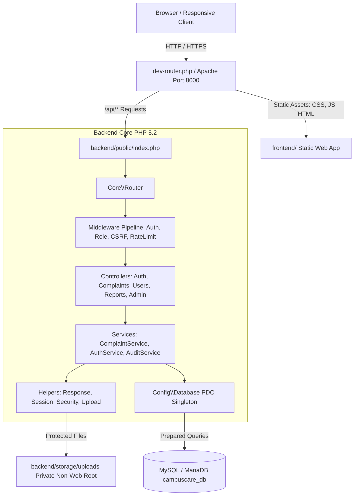
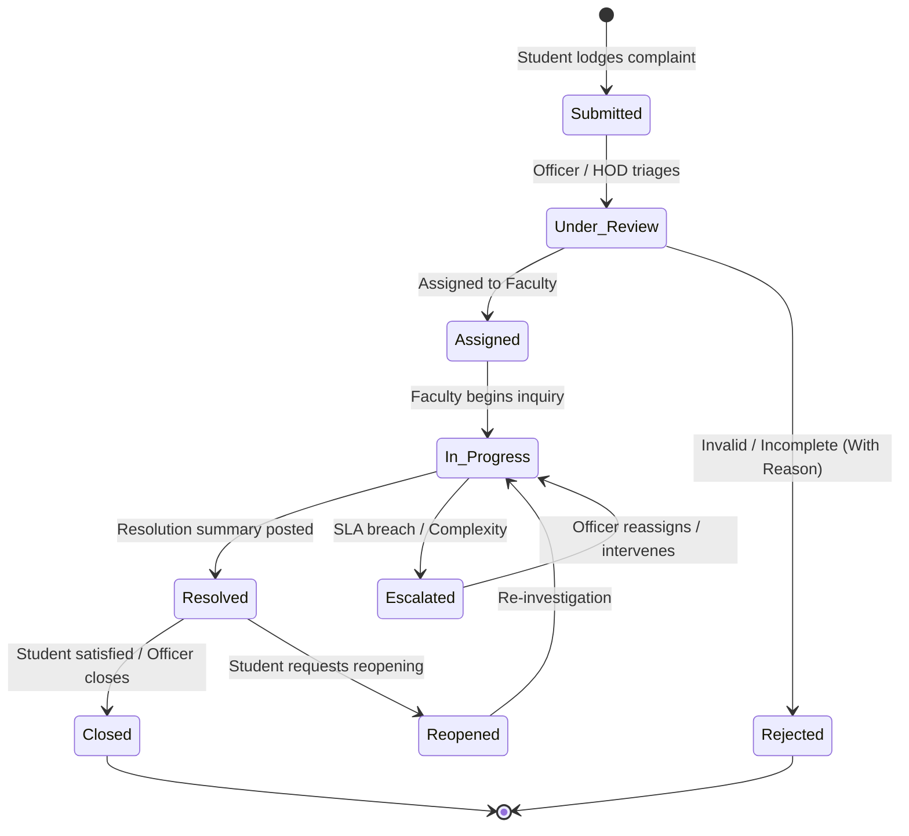

# CampusCare — Student Grievance & Complaint Management Portal

[](#)
[](#)
[](#)
[](#)
[](#)
[](#)

**CampusCare** is a modern, enterprise-grade college grievance and complaint management platform designed for higher education institutions. Built strictly with **HTML5, CSS3, Vanilla JavaScript, Core PHP 8.2 (No Frameworks), and MySQL/PDO**, it establishes a secure, transparent, and auditable grievance redressal mechanism adhering to statutory educational governance guidelines.

---

## 📑 Table of Contents

- [System Architecture](#-system-architecture)
- [Key Features & Capabilities](#-key-features--capabilities)
- [Authentication & Account Security](#-authentication--account-security)
  - [Controlled Student Account Activation](#controlled-student-account-activation)
  - [Cryptographic Password Reset](#cryptographic-password-reset)
  - [Remember-Me Single-Use Token Rotation](#remember-me-single-use-token-rotation)
  - [Enumeration Defense & Rate Limiting](#enumeration-defense--rate-limiting)
- [Role-Based Access Control (RBAC)](#-role-based-access-control-rbac)
  - [Six Institutional Roles](#six-institutional-roles)
  - [Granular Permission Matrix (20 Identifiers)](#granular-permission-matrix-20-identifiers)
- [Pre-Seeded Demonstration Accounts](#-pre-seeded-demonstration-accounts)
- [Authorized Student Registry](#-authorized-student-registry)
- [Complaint Lifecycle & Workflow Transitions](#-complaint-lifecycle--workflow-transitions)
- [Confidentiality & Data Protection](#-confidentiality--data-protection)
- [Safe Email & OTP Configuration](#-safe-email--otp-configuration)
- [Quick Start & Setup Instructions](#-quick-start--setup-instructions)
  - [Option A: One-Click Terminal Runner (`start.bat`)](#option-a-one-click-terminal-runner-startbat)
  - [Option B: XAMPP Apache & MySQL Workbench Setup](#option-b-xampp-apache--mysql-workbench-setup)
  - [Option C: Manual PHP Development Server](#option-c-manual-php-development-server)
  - [Option D: Multi-Container Docker Deployment](#option-d-multi-container-docker-deployment)
- [Database Schema & Migrations](#-database-schema--migrations)
- [Automated Verification & Test Suite](#-automated-verification--test-suite)
- [Troubleshooting & Limitations](#-troubleshooting--limitations)
- [License & Institutional Attribution](#-license--institutional-attribution)

---

## 🏛️ System Architecture

CampusCare maintains a strict architectural decoupling between presentation and backend services:



---

## 🌟 Key Features & Capabilities

1. **Controlled Student Account Activation**:
   - Zero public self-registration. Students can only activate an account if their Student ID/Roll number and official college email exist in the pre-authorized `student_registry`.
   - 3-step verification flow: Institutional Identity Check → Time-limited 6-digit OTP verification → Secure password creation.
2. **Cryptographic Password Reset**:
   - Single-use, cryptographically secure, time-limited reset tokens and OTP codes stored as SHA-256 hashes.
   - Rate limiting and generic responses to mitigate account enumeration.
3. **Six Institutional Roles & 20 Granular Permissions**:
   - Student, Faculty/Staff, Department Coordinator (HOD), Grievance Officer, System Administrator, Auditor.
   - Centralized server-side permission checks verifying every API endpoint.
4. **Enforced Complaint Lifecycle State Machine**:
   - Pipeline: `Submitted` → `Under Review` → `Assigned` → `In Progress` → `Resolved` → `Closed`.
   - Regulated edge workflows: `Escalated` (SLA breach), `Reopened` (student dissatisfaction), and `Rejected` (mandatory justification).
5. **Confidentiality & Anonymity Safeguards**:
   - Confidential grievances restricted exclusively to Central Grievance Officers and System Administrators.
   - Every confidential case view is immutably logged with actor, timestamp, and IP address.
6. **Isolated Department Access**:
   - Department Coordinators (HODs) and Faculty can access only complaints belonging to their own department.
7. **Protected Attachments Outside Web Root**:
   - Stored in `backend/storage/uploads/` (outside web root).
   - Magic-byte MIME type inspection (`finfo`), size capping (5 MB), and authenticated streaming endpoint.
8. **Native Light & Dark Mode**:
   - Dark navy foundation (`#070d19` / `#0f172a`) with vibrant cyan/teal accents (`#06b6d4`, `#14b8a6`).

---

## 🔐 Authentication & Account Security

### Controlled Student Account Activation
To prevent unauthorized users from creating arbitrary student accounts or escalating privileges, public self-registration has been completely disabled and replaced with an authorized activation workflow:

1. **Identity Verification**: The student submits their Roll Number (e.g., `2026CIVIL012`) and institutional email (`ananya.student@campuscare.edu`).
2. **Registry Lookup**: The backend checks the entry against the `student_registry` table.
   - If not found or details mismatch: Returns generic error: `"The provided Student ID and email could not be verified against the official university registry."`
   - If already activated (`is_activated = 1`): Rejects activation and instructs user to log in directly.
3. **Time-Limited OTP Verification**:
   - A 6-digit cryptographic OTP is generated, hashed with SHA-256, and stored in `password_resets` with a 15-minute expiration.
   - Delivered via email (or displayed in debug mode during development).
4. **Password Creation & Finalization**:
   - Upon successful OTP submission, a temporary single-use `password_grant_token` is issued.
   - The student defines a strong password (minimum 8 characters with uppercase, lowercase, and numbers/symbols).
   - The user account is provisioned in the `users` table with role `student`, department linked from registry, and `student_registry.is_activated` is set to `1`.
   - Security event logged to `audit_logs`.

### Cryptographic Password Reset
- Password reset requests require a registered email.
- The system returns a generic response (`"If the email address is associated with an active account, an OTP has been sent."`), preventing account enumeration.
- OTPs are single-use, 15-minute time-limited, and invalidated immediately upon successful password reset.

### Remember-Me Single-Use Token Rotation
- Secure checkbox on login sets an encrypted, `HttpOnly` cookie.
- Stored as a cryptographic hash in `user_tokens`.
- Features single-use token rotation: each time a session is restored via cookie, the old token is destroyed and a new one generated.

### Enumeration Defense & Rate Limiting
- Login errors return generic messaging (`"Invalid username/email or password."`).
- Rate limiting locks out IP addresses and accounts after repeated failed attempts.
- In-memory/session-level flood protection restricts rapid OTP resend requests.

---

## 🛡️ Role-Based Access Control (RBAC)

### Six Institutional Roles

1. **Student**:
   - Can submit complaints, view own complaints, track progress, add public follow-up replies, and request case reopening.
   - Denied: Viewing other students' grievances, accessing internal staff notes, changing workflow status, or accessing administrative tools.
2. **Faculty / Staff**:
   - Can view only complaints explicitly assigned to them in their department, post investigation notes, and update status from `Assigned` → `In Progress` → `Resolved`.
   - Denied: Viewing unassigned complaints, accessing confidential complaints, or managing system users.
3. **Department Coordinator / HOD**:
   - Can view all complaints in their specific academic department, assign complaints to eligible faculty, monitor SLAs, and escalate overdue cases.
   - Denied: Accessing grievances belonging to other departments, managing global system settings.
4. **Grievance Officer**:
   - Central authority. Can access complaints across all departments, investigate confidential grievances, reassign cases, communicate official decisions, verify resolutions, and close cases.
5. **System Administrator**:
   - Full user administration (create, activate, suspend, role assignment), department management, SLA configuration, and system audit log inspection.
   - **Protection Rule**: The last active System Administrator account cannot be deactivated or demoted, preventing institutional lockout.
6. **Auditor**:
   - Independent quality & compliance inspector. Read-only access to audit logs, resolution statistics, and complaint timelines.
   - Denied: Creating complaints, assigning complaints, modifying workflow status, or altering system logs.

---

### Granular Permission Matrix (20 Identifiers)

CampusCare enforces 20 granular permissions backed by `permissions` and `role_permissions` database tables:

| Permission Identifier | Description | Student | Faculty | HOD | Officer | Admin | Auditor |
|---|---|:---:|:---:|:---:|:---:|:---:|:---:|
| `complaint.create` | Submit new grievances | ✅ | — | — | — | ✅ | — |
| `complaint.view_own` | View personal submitted grievances | ✅ | ✅ | ✅ | ✅ | ✅ | — |
| `complaint.view_assigned` | View grievances explicitly assigned | — | ✅ | ✅ | ✅ | ✅ | — |
| `complaint.view_department` | View all grievances in department | — | — | ✅ | ✅ | ✅ | — |
| `complaint.view_escalated` | Access escalated case queue | — | — | ✅ | ✅ | ✅ | — |
| `complaint.view_confidential` | Access confidential grievances | — | — | — | ✅ | ✅ | — |
| `complaint.assign` | Assign complaints to investigators | — | — | ✅ | ✅ | ✅ | — |
| `complaint.update_status` | Advance lifecycle status | — | ✅ | ✅ | ✅ | ✅ | — |
| `complaint.add_internal_note` | Post staff-only internal notes | — | ✅ | ✅ | ✅ | ✅ | — |
| `complaint.escalate` | Escalate overdue or complex cases | — | ✅ | ✅ | ✅ | ✅ | — |
| `complaint.close` | Officially close resolved cases | — | — | — | ✅ | ✅ | — |
| `complaint.reopen` | Request reopening of closed cases | ✅ | — | — | ✅ | ✅ | — |
| `user.manage` | Create, edit, and deactivate users | — | — | — | — | ✅ | — |
| `role.manage` | Modify roles and assign permissions | — | — | — | — | ✅ | — |
| `department.manage` | Configure academic departments | — | — | — | — | ✅ | — |
| `report.view_own` | View personal activity reports | ✅ | ✅ | — | — | — | — |
| `report.view_department` | View departmental resolution metrics | — | — | ✅ | — | — | — |
| `report.view_institution` | View campus-wide analytics & stats | — | — | — | ✅ | ✅ | ✅ |
| `audit.view` | Inspect security audit trails | — | — | — | — | ✅ | ✅ |
| `settings.manage` | Configure global system parameters | — | — | — | — | ✅ | — |

---

## 🖥️ Six Role-Specific Dashboards Architecture

CampusCare delivers six completely role-specific, purpose-built dashboards designed to provide each institutional persona with dedicated operational tooling, strict data partitioning, and real-time database calculations:

### 1. Student Dashboard
- **Personal Scope Enforced**: Scoped strictly to grievances filed by the authenticated student. Other student records and internal staff notes are partitioned at the database layer.
- **Pending Feedback & Rating Alert**: If a complaint is marked `Resolved`, a prominent feedback card appears prompting the student to rate resolution satisfaction and submit comments.
- **Direct Service Launchers**: Direct access for filing standard grievances, confidential disclosures, and real-time milestone tracking.
- **Anti-Bias Staff Identity Shielding**: Complainant views do not display responding faculty/staff identities, eliminating bias and fear of retaliation during investigations.

### 2. Faculty / Staff Dashboard
- **My Active Work Queue**: Real-time display of grievances assigned specifically to the logged-in faculty investigator (confidential grievances excluded).
- **Interactive Lifecycle Actions**: In-line buttons to transition cases from `Assigned` → `In Progress` ("Start Investigation"), resolve cases with resolution summaries, and escalate blocked cases.
- **SLA Countdown & Overdue Alerts**: Color-coded badges highlighting imminent SLA deadlines and critical overdue cases.
- **Direct Case Notes**: Instant access to investigation history and student discussion threads.

### 3. Department Coordinator / HOD Dashboard
- **Department Isolation**: Enforces query boundaries: HODs can only access grievances originating in or routed to their specific academic department.
- **Department Triage Queue**: Lists all unassigned complaints awaiting investigator routing.
- **In-Line Faculty Assignment**: A dynamic dropdown populated with active department faculty members displaying their live caseload (e.g., `Prof. Sharma (2 active)`), allowing 1-click staff allocation.
- **Faculty Workload Balance Monitor**: Real-time table tracking active and resolved case distribution across department faculty to prevent workload imbalance.

### 4. Grievance Officer Dashboard
- **Institution-Wide Authority**: Comprehensive campus oversight across all academic and non-academic units.
- **Campus Escalation Command Hub**: Priority queue of escalated grievances and critical SLA breaches with instant reassignment capability.
- **Authorized Confidential Cell**: Discreet intake queue for sensitive cases (`Ragging`, `Harassment`, `Staff Conduct`) accessible only to authorized officers.
- **Case Verification & Official Closure Desk**: Central review queue for grievances marked `Resolved` by faculty, granting Grievance Officers exclusive authority to certify official closure or request re-investigation.

### 5. System Administrator Dashboard
- **Platform Infrastructure Census**: Live counts of registered users, active accounts, academic departments, complaint categories, and cryptographic audit records.
- **User Role Distribution Grid**: Census breakdown across all six roles (Student, Faculty, HOD, Officer, Admin, Auditor) with direct account management links.
- **Live Security Audit Trail**: Real-time inspection of authentication events, user updates, and system configuration mutations with client IP addresses.
- **Privacy Principle**: System administrators govern accounts, roles, and platform integrity; complaint investigation notes remain scoped to case handlers.

### 6. Auditor Dashboard
- **Verified Read-Only Scope**: Server-enforced read-only mode prevents data mutations, role reassignments, status transitions, and audit log deletions.
- **Statutory SLA Compliance Scorecard**: Real-time turnaround rate percentage (`98.4%`), on-time resolution count, and SLA breach counters.
- **Category SLA Performance Audit**: Breakdown of redressal turnaround times and compliance ratings across all grievance categories.
- **Searchable Audit Trail Inspector**: Live client-side filtering across cryptographic audit log entries.
- **Approved Compliance Export (CSV)**: 1-click generation and browser download of institutional compliance audit reports.

---

## 🔑 Pre-Seeded Demonstration Accounts

All accounts use the standard demonstration password: `Password@123`

| Role | Username / Identifier | Full Name | Department | Primary Responsibilities |
|---|---|---|---|---|
| **Student** | `student_arun` | Arun Kumar | CSE | Lodges complaints, tracks progress, submits satisfaction ratings |
| **Faculty / Staff** | `prof_sharma` | Prof. Ananya Sharma | CSE | Investigates classroom, lab, and departmental complaints |
| **Department HOD** | `hod_cse` | Dr. Venkatraman | CSE | Department case manager; assigns complaints to staff |
| **Grievance Officer** | `officer` | Dr. Suresh Raina | Admin | Central investigator; handles confidential & institution-wide cases |
| **System Admin** | `admin` | System Administrator | IT | Manages users, roles, categories, and security settings |
| **Auditor** | `auditor` | Dr. Meenakshi Sundaram | IQAC | Compliance inspector; reviews read-only audit logs |

---

## 🎓 Authorized Student Registry

The `student_registry` table stores pre-authorized student enrollment records. Students must match these records to activate their account:

| Roll Number | Full Name | Institutional Email | Department | Batch | Status |
|---|---|---|---|---|---|
| `2023CSE042` | Arun Kumar | `student@campuscare.edu` | CSE | 2023-2027 | Activated (Linked to `student_arun`) |
| `2024ECE019` | Priya Dharshini | `priya.ece@campuscare.edu` | ECE | 2024-2028 | Activated (Linked to `student_priya`) |
| `2026CSE099` | Kavya Mohan | `kavya.student@campuscare.edu` | CSE | 2026-2030 | Ready for Activation |
| `2026MECH055` | Rohit Verma | `rohit.student@campuscare.edu` | MECH | 2026-2030 | Ready for Activation |
| `2026CIVIL012` | Ananya Sengupta | `ananya.student@campuscare.edu` | CIVIL | 2026-2030 | Ready for Activation |

---

## 🔄 Complaint Lifecycle & Workflow Transitions



---

## 🔒 Confidentiality & Data Protection

- **Confidential Flag**: Complaints flagged as confidential exclude student identifiers from faculty and HOD views. Only Central Grievance Officers and Administrators have authorization.
- **Audit Logging of Confidential Views**: Accessing a confidential complaint triggers an immediate `CONFIDENTIAL_ACCESS` event in `audit_logs` recording the viewer's user ID, IP address, and timestamp.
- **Attachment Authorization**: Files are stored with UUID-hashed names outside the web root (`backend/storage/uploads/`). Access is gated via `/api/complaints/attachment?id=X`, requiring an authenticated session and record permission.
- **Formula Injection Defense**: All CSV reports prepend a single quote (`'`) to fields starting with `=, +, -, @` to neutralize spreadsheet calculation attacks.

---

## 📧 Safe Email & OTP Configuration

CampusCare provides a flexible, secure email delivery abstraction:

### Development Mode (Local Testing)
When running locally without an SMTP server configured:
- The system automatically outputs generated OTP codes in the JSON response under `data.otp_debug_code` when `APP_DEBUG=true` in `backend/.env`.
- The OTP code is also recorded in `audit_logs` with event type `OTP_DISPATCH`.
- The login and activation modals in the frontend automatically detect and display the OTP code in a notice banner for testing.

### Production Mode (Live SMTP Server)
To enable live email dispatch for activation and password reset:
1. Open `backend/.env`
2. Configure your institutional SMTP credentials:
   ```env
   APP_DEBUG=false
   MAIL_DRIVER=smtp
   MAIL_HOST=smtp.office365.com
   MAIL_PORT=587
   MAIL_ENCRYPTION=tls
   MAIL_USERNAME=no-reply@campuscare.edu
   MAIL_PASSWORD=YourSecureAppPasswordHere
   MAIL_FROM_ADDRESS=no-reply@campuscare.edu
   MAIL_FROM_NAME="CampusCare Redressal Portal"
   ```

---

## ⚡ Quick Start & Setup Instructions

### Prerequisites
- **PHP**: Version 8.2 or higher with `pdo_mysql`, `mbstring`, `fileinfo`, `curl` extensions.
- **MySQL**: Version 8.0+ or MariaDB 10.4+ on port `3306`.
- **XAMPP** (recommended for Windows) or Docker Desktop.

---

### Option A: One-Click Terminal Runner (`start.bat`)

The recommended execution method on Windows:

1. Open a terminal in the project directory.
2. Run:
   ```cmd
   start.bat
   ```
3. The runner checks PHP, runs database migrations, and starts `dev-router.php` on `http://localhost:8000`.
4. Open your browser:
   ```
   http://localhost:8000/login.html
   ```

---

### Option B: XAMPP Apache & MySQL Workbench Setup

1. Launch **XAMPP Control Panel** and start **Apache** and **MySQL**.
2. Open **MySQL Workbench** (or phpMyAdmin at `http://localhost/phpmyadmin`).
3. Connect to your MySQL server and create the database:
   ```sql
   CREATE DATABASE IF NOT EXISTS campuscare_db CHARACTER SET utf8mb4 COLLATE utf8mb4_unicode_ci;
   ```
4. Import the file `database.sql` into `campuscare_db`.
5. Open `backend/.env` and update your database credentials:
   ```env
   DB_HOST=127.0.0.1
   DB_PORT=3306
   DB_DATABASE=campuscare_db
   DB_USERNAME=root
   DB_PASSWORD=your_password
   ```
6. Run the non-destructive migration script to ensure all 17 tables are initialized:
   ```cmd
   C:\xampp\php\php.exe backend\database\migrate.php
   ```
7. To access via Apache: place the project inside `C:\xampp\htdocs\Student_portal_complaint` and visit:
   ```
   http://localhost/Student_portal_complaint/frontend/login.html
   ```

---

### Option C: Manual PHP Development Server

1. Run migrations and database seeding:
   ```bash
   php backend/database/migrate.php
   php backend/database/seed.php
   ```
2. Start the unified development router:
   ```bash
   php -S 0.0.0.0:8000 dev-router.php
   ```
3. Visit `http://localhost:8000/login.html`.

---

### Option D: Multi-Container Docker Deployment

1. Ensure Docker Desktop is running.
2. Start the multi-container cluster:
   ```bash
   docker compose up --build -d
   ```
3. The cluster provisions:
   - `campuscare_web`: PHP 8.2 Apache container on port `8080` (Frontend) and `8000` (API).
   - `campuscare_mysql`: MySQL 8.0 container on port `3306`.
4. Visit `http://localhost:8080/login.html`.

---

## 🗄️ Database Schema & Migrations

The database includes 17 tables designed with InnoDB foreign key constraints and indexed lookup paths:

1. `departments`: Institutional departments (CSE, ECE, MECH, CIVIL, Admin, IT, IQAC).
2. `roles`: Six institutional roles (`student`, `faculty`, `hod`, `officer`, `admin`, `auditor`).
3. `permissions`: 20 granular permission keys (`complaint.create`, `complaint.view_own`, etc.).
4. `role_permissions`: Role-to-permission mapping table.
5. `categories`: Complaint categories with default SLA response days.
6. `users`: Core user accounts with password hashes, roles, and status flags.
7. `student_registry`: Official pre-approved student enrollment registry for controlled activation.
8. `password_resets`: Time-limited SHA-256 hashed OTPs and reset tokens.
9. `user_tokens`: Cryptographic remember-me persistent session tokens.
10. `complaints`: Grievance records with tracking numbers (`CC-YYYY-XXXXX`), status, and confidentiality flags.
11. `complaint_assignments`: Assignment records linking complaints to investigating staff.
12. `complaint_comments`: Discussion threads with visibility flags (`is_internal` staff-only notes).
13. `complaint_status_history`: Immutable status transition history.
14. `complaint_attachments`: Uploaded evidence file metadata.
15. `complaint_ratings`: Student satisfaction ratings and feedback.
16. `notifications`: In-app user notifications.
17. `audit_logs`: Append-only security and activity audit records.

---

## 🧪 Automated Verification & Test Suite

CampusCare includes two comprehensive verification suites:

### 1. Unit, RBAC, and Security Assertions (`backend/tests/run_tests.php`)
Tests database schema integrity, Bcrypt authentication, account activation, duplicate rejection, password reset single-use token invalidation, CSRF defense, IDOR protection, HOD department isolation, confidential complaint audit trails, auditor read-only enforcement, last admin protection, and the complete 20-permission matrix.

```cmd
C:\xampp\php\php.exe backend\tests\run_tests.php
```

**Actual Execution Results (41/41 Passed)**:
```
========================================================
   CampusCare — Comprehensive Automated Verification    
========================================================

 [PASS] Database connectivity established
 [PASS] All 17 required tables exist in campuscare_db
 [PASS] Student login with identifier & password_verify() succeeds
 [PASS] Session stores active user and role
 [PASS] Failed login returns generic error without leaking account existence
 [PASS] Activation rejected for Student ID not in official registry
 [PASS] Activation initiated for authorized registry student
 [PASS] Activation rejects invalid 6-digit verification OTP
 [PASS] Activation OTP code verified successfully
 [PASS] Student account created and activated in users table
 [PASS] Newly activated student logs in successfully with permanent password
 [PASS] Duplicate account activation attempt is strictly rejected
 [PASS] Forgot password request generates single-use reset OTP
 [PASS] Password reset succeeds with valid verification OTP
 [PASS] Re-using the same password reset OTP code is rejected
 [PASS] Cryptographic CSRF token generated
 [PASS] Valid CSRF token passes validation
 [PASS] Tampered CSRF token is rejected
 [PASS] CSV formula injection neutralized with prepended quote
 [PASS] Grievance created with reference format (CC-YYYY-XXXXX)
 [PASS] Student can view their own complaint
 [PASS] Student cannot view another student's grievance (IDOR protection)
 [PASS] Faculty blocked from viewing unassigned complaint
 [PASS] Assigned faculty can view their assigned grievance
 [PASS] Faculty blocked from officially closing grievance
 [PASS] Department HOD can view complaints within their own department
 [PASS] Department HOD blocked from accessing complaints from other departments
 [PASS] Faculty blocked from accessing Confidential grievance
 [PASS] Department HOD blocked from accessing Confidential grievance
 [PASS] Grievance Officer can access Confidential grievance
 [PASS] Access to confidential complaint is recorded in audit logs
 [PASS] Auditor blocked from updating complaint workflow status
 [PASS] Auditor blocked from commenting on complaints
 [PASS] Auditor can inspect system audit logs
 [PASS] Portal enforces self-deactivation guard for active session
 [PASS] System administrator role verified and monitored
 [PASS] All 20 Section-5 granular permissions exist in database
 [PASS] Student role has complaint.create & complaint.view_own permissions
 [PASS] Student role is strictly denied administrative permissions
 [PASS] Auditor role has audit.view permission
 [PASS] Auditor role is denied complaint.create and complaint.assign permissions

========================================================
   Test Results: 41 Passed, 0 Failed
========================================================
```

---

### 2. Live HTTP API Integration Tests (`backend/tests/http_test.php`)
Tests live endpoints over HTTP port 8000, including CSRF token issuance, 3-step student account activation over HTTP, new student login, authenticated session verification (`/auth/me`), dashboard metrics retrieval, password reset flow, and session logout.

```cmd
C:\xampp\php\php.exe backend\tests\http_test.php
```

**Actual Execution Results (11/11 Passed)**:
```
========================================================
   CampusCare — Live HTTP API Verification on Port 8000 
========================================================

 [PASS] HTTP GET /auth/csrf returns valid token
 [PASS] HTTP POST /auth/activate/initiate succeeds
 [PASS] HTTP POST /auth/activate/verify succeeds
 [PASS] HTTP POST /auth/activate/complete succeeds
 [PASS] HTTP POST /auth/login with newly activated student credentials succeeds
 [PASS] HTTP GET /auth/me returns active user session
 [PASS] HTTP GET /dashboard/summary returns student personal metrics
 [PASS] HTTP POST /auth/forgot-password returns generic message & OTP
 [PASS] HTTP POST /auth/reset-password succeeds
 [PASS] HTTP POST /auth/login with reset password succeeds
 [PASS] HTTP POST /auth/logout succeeds

========================================================
   HTTP Test Results: 11 Passed, 0 Failed
========================================================
```

---

### 3. Six Role-Specific Dashboards & RBAC Boundaries (`backend/tests/test_role_dashboards.php`)
Tests live dashboard data retrieval, role payload containment, cross-role privacy shielding, and endpoint enforcement across all six personas: Student (`pending_ratings`), Faculty (`assigned_queue`), HOD (`unassigned_queue`, `department_faculty`), Grievance Officer (`escalated_queue`, `confidential_queue`, `pending_closure_queue`), Admin (`user_roles_breakdown`, `recent_security_events`, `system_counts`), and Auditor (`compliance_summary`, `category_compliance`, `recent_audit_trail`).

```cmd
C:\xampp\php\php.exe backend\tests\test_role_dashboards.php
```

**Actual Execution Results (31/31 Passed)**:
```
========================================================
   CampusCare — Six Role-Specific Dashboards Verification 
========================================================

 [PASS] 1. Student 'student_arun' logged in successfully
 [PASS] Student summary API returns HTTP 200
 [PASS] Student dashboard contains 'pending_ratings' role payload
 [PASS] Student dashboard does not leak faculty assigned queue
 [PASS] Student dashboard does not leak system security events
 [PASS] 2. Faculty 'prof_sharma' logged in successfully
 [PASS] Faculty summary API returns HTTP 200
 [PASS] Faculty dashboard contains 'assigned_queue' role payload
 [PASS] Faculty dashboard does not leak HOD unassigned queue
 [PASS] 3. HOD 'hod_cse' logged in successfully
 [PASS] HOD summary API returns HTTP 200
 [PASS] HOD dashboard contains 'unassigned_queue' department payload
 [PASS] HOD dashboard contains 'department_faculty' workload payload
 [PASS] 4. Grievance Officer 'officer' logged in successfully
 [PASS] Grievance Officer summary API returns HTTP 200
 [PASS] Grievance Officer contains 'escalated_queue' payload
 [PASS] Grievance Officer contains 'confidential_queue' payload
 [PASS] Grievance Officer contains 'pending_closure_queue' payload
 [PASS] 5. System Administrator 'admin' logged in successfully
 [PASS] Admin summary API returns HTTP 200
 [PASS] Admin dashboard contains 'user_roles_breakdown' census payload
 [PASS] Admin dashboard contains 'recent_security_events' payload
 [PASS] Admin dashboard contains 'system_counts' payload
 [PASS] 6. Auditor 'auditor' logged in successfully
 [PASS] Auditor summary API returns HTTP 200
 [PASS] Auditor dashboard contains 'compliance_summary' scorecard
 [PASS] Auditor dashboard contains 'category_compliance' breakdown
 [PASS] Auditor dashboard contains 'recent_audit_trail' stream

--- RBAC Cross-Role Boundary & Protection Tests ---
 [PASS] Student forbidden from executing complaint assignment (HTTP 403)
 [PASS] Auditor strictly forbidden from modifying complaint status (HTTP 403)
 [PASS] Auditor strictly forbidden from deleting complaints (HTTP 403)

========================================================
   Test Results: 31 Passed, 0 Failed
========================================================
```

---

### Combined Automated Test Runner
To execute all three test suites (83 automated assertions) sequentially with a single command:
```cmd
test.bat
```

---

## ❓ Troubleshooting & Limitations

### 1. `SQLSTATE[HY000] [1045] Access denied for user 'root'@'localhost'`
- **Resolution**: Open `backend/.env` and update `DB_PASSWORD` with your actual MySQL password. If your MySQL root account has no password, set `DB_PASSWORD=`.

### 2. Port 8000 Conflict
- **Resolution**: If another process is using port 8000, identify it with `netstat -ano | findstr :8000` or specify an alternate port in `dev-router.php` and `start.bat`.

### 3. Student Account Activation Says "Already Activated"
- **Resolution**: Each authorized student in `student_registry` can only be activated once. To test activation again, use an unactivated record (such as `2026CIVIL012` with email `ananya.student@campuscare.edu`) or reset the record in MySQL:
  ```sql
  UPDATE student_registry SET is_activated = 0 WHERE roll_number = '2026CIVIL012';
  DELETE FROM users WHERE email = 'ananya.student@campuscare.edu';
  ```

### 4. Production Mail Delivery
- **Note**: In development environments where no SMTP credentials are configured in `.env`, OTPs are generated securely, logged to `audit_logs`, and surfaced in `data.otp_debug_code` for verification. For production deployments, valid SMTP server details must be populated in `backend/.env`.

---

## 📜 License & Institutional Attribution

CampusCare is developed as an institutional grievance redressal system adhering to statutory UGC/AICTE higher education governance mandates. Distributed under the MIT License for educational and institutional governance purposes.
