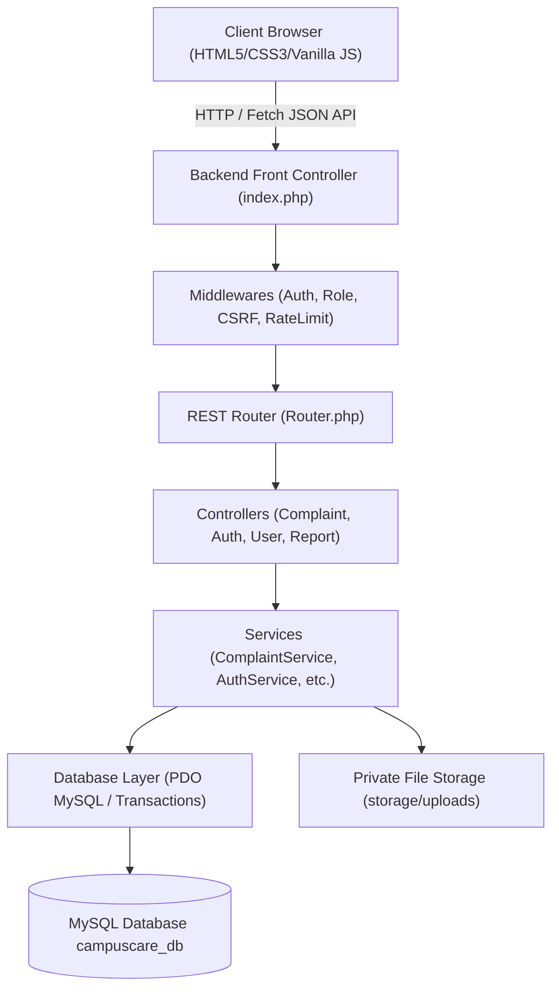

# CampusCare — Architectural Overview

## 1. System Philosophy
CampusCare is engineered specifically as a scalable, clean, and secure college grievance redressal portal. It is structured according to strict separation of concerns:
- **Frontend Layer**: Vanilla HTML5, CSS3, and JavaScript utilizing the native Fetch API. Completely decoupled from database queries.
- **Backend Layer**: Core PHP 8.2+ without heavy frameworks. Leverages PDO for all database operations, front-controller routing, clean service abstractions, and robust middleware.
- **Storage Layer**: Relational MySQL/MariaDB database with strict foreign keys, indexes, and transactions.

## 2. Request Lifecycle
1. The browser initiates a request with session cookies (`credentials: 'include'`).
2. `backend/public/index.php` loads configuration, registers the global exception handler, initializes session handlers, and registers routes.
3. The `Router` inspects the HTTP method and URI.
4. Active middlewares execute sequentially:
   - `AuthMiddleware` verifies session presence.
   - `RoleMiddleware` validates user role privilege.
   - `CsrfMiddleware` enforces token authenticity on POST/PUT/DELETE mutations.
   - `RateLimitMiddleware` throttles brute-force login attempts.
5. The target Controller method executes and calls the appropriate Service.
6. The Service performs business logic, checks record ownership and confidentiality flags, and accesses MySQL via PDO prepared statements.
7. `Response::json()` sends consistent JSON responses with HTTP security headers (`nosniff`, `SAMEORIGIN`, `XSS-Protection`).
